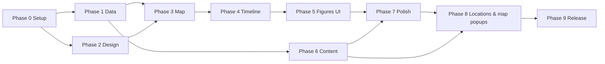

# PLAN.md: Philosophy Timeline Atlas

> Read [CONTEXT.md](./CONTEXT.md) before starting any task.
> Each task is small enough for one session or PR. Mark status like this: `[ ]` todo · `[/]` in progress · `[x]` done.
> A task is **done** only when every acceptance criterion (✅) is met.

---

## Open questions (resolve before or during Phase 0)

| # | Question | Status / Answer |
|---|---|---|
| Q1 | Timeline direction: old dates on the **right** (RTL) or the left? | ✅ **Resolved:** right (old) → left (new) |
| Q2 | Numerals: Eastern Arabic (٤٧٠) or Western (470)? | ✅ **Resolved:** Eastern Arabic in UI |
| Q3 | Should the popup show the figure's **modern country** too, or only the ancient place? | ✅ **Resolved:** show both ancient place and modern country |
| Q4 | Final font pair? | ✅ **Resolved:** Cairo (UI) + Amiri (text) |
| Q5 | Hosting target? | ✅ **Resolved:** GitHub Pages |
| Q6 | Is GPL-3.0 (historical-basemaps) acceptable for this project's license? | ✅ **Resolved:** yes, project is GPL-3.0 |
| Q7 | Include early wisdom literature & religious thinkers? | ✅ **Resolved:** include, classified by `kind` field |

---

## Phase 0: Setup & decisions

- [x] **T0.1 Resolve open questions** with the project owner, then update CONTEXT.md (§6, §9). All questions Q1–Q7 resolved.
  - ✅ No open question is left on "default" without the owner agreeing.
- [x] **T0.2 Init repo**: `git init`, `.gitignore`, `README.md` (short, links to CONTEXT/PLAN), **GPL-3.0** `LICENSE`.
  - ✅ Repo builds from a clean clone.
- [x] **T0.3 Scaffold Vite (vanilla JS)** in the repo root: `npx -y create-vite@latest ./ --template vanilla`.
  - ✅ `npm run dev` serves the page. Template boilerplate removed.
- [x] **T0.4 Create directory skeleton** as in CONTEXT.md §3 (empty files/folders, `.gitkeep`).
  - ✅ The tree matches CONTEXT.md §3.

## Phase 1: Data foundation (before any UI)

- [x] **T1.1 Write the JSON Schema** (`scripts/schema/figure.schema.json`) from CONTEXT.md §4.2.
  - ✅ Schema covers required fields (including `kind` enum: `philosopher` | `sage` | `religious-thinker`, and boolean `legendary`), the year integer rule, and `id` pattern.
- [x] **T1.2 `validate-data.mjs`**: checks schema, unique ids/QIDs, no year 0, `birth ≤ active.from ≤ active.to ≤ death`, lat/lng ranges, valid `civilization` and `era` refs, and `legendary: true` ⇒ `approx: true` + non-empty `notes`.
  - ✅ `npm run validate` exits non-zero on any violation and passes on valid data.
- [x] **T1.3 `civilizations.json`**: egypt, mesopotamia, persia, india, china, greece, with Arabic names, colors, center, zoom.
- [x] **T1.4 `fetch-wikipedia.mjs`**:
  - Uses `https://ar.wikipedia.org/api/rest_v1/page/summary/{title}` for `extract`, thumbnail, and page URL.
  - Uses the Wikidata API (`wbgetentities`) to confirm the QID ↔ ar.wikipedia sitelink match and to get image license metadata from Commons.
  - Sends a `User-Agent` header, rate-limits requests, caches responses locally (`.cache/`), and runs incrementally.
  - Fails loudly on a QID/title mismatch.
  - ✅ Running it produces `public/data/figures.json` and a report listing missing Arabic articles.
- [x] **T1.5 Download historical borders** from `aourednik/historical-basemaps` for MVP years (check the available files in the repo; expected around bc3000, bc2000, bc1500, bc1000, bc700, bc500, bc400, bc323, bc300, bc200, bc100, bc1).
  - Simplify geometries (e.g. `mapshaper`) to keep each file < ~500 KB.
  - ✅ Files sit in `public/data/borders/` with a `manifest.json` listing year → file.
- [x] **T1.6 Arabic polity names**: map the English `NAME` values in the border files to Arabic (`content/polity-names-ar.json`). Unknown names fall back to no label, never to English.
  - ✅ Every polity visible in MVP years has an Arabic name, or is listed as untranslated in a report.

## Phase 2: Design system

- [x] **T2.1 `tokens.css`**: color palette (ink/navy background, parchment, gold, one color per civilization), spacing scale, radii, shadows, glass panel tokens, font stacks, motion durations.
- [x] **T2.2 `base.css`**: modern reset, `dir="rtl"` defaults, logical properties, Arabic typography (line-height, sizes), focus styles.
- [x] **T2.3 Component styles**: glass panel, button, icon button, chip/tag, badge ("تأريخ تقريبي" and "شخصية شبه أسطورية"), kind chips (فيلسوف / حكيم / مفكّر ديني), card, tooltip.
  - ✅ A temporary `/styleguide.html` page shows every component in RTL.
- [x] **T2.4 (optional) Mockup**: generate a UI mockup image and get owner approval before Phase 3.

## Phase 3: Map

- [x] **T3.1 Leaflet setup** (`src/map/map.js`): full-viewport map with an unlabeled base layer, sensible zoom limits, and attribution control on the **left** (RTL).
- [x] **T3.2 Border layer** (`src/map/borders.js`): loads the GeoJSON for the closest available year **≤** the current timeline year, styles polygons, shows Arabic polity labels, cross-fades between years, and caches loaded files.
  - ✅ Moving the timeline swaps the borders without a visible flash or memory growth.
- [x] **T3.3 RTL fixes for Leaflet**: zoom controls, popups, attribution, and tooltips display correctly with `dir="rtl"`.

## Phase 4: Timeline

- [x] **T4.1 Timeline component** (`src/timeline/`): range -3000 → 0 with no year 0, **old on the right → new on the left** (CONTEXT §6.2), a tick per century, labels in **Eastern Arabic numerals** with ق.م/م (CONTEXT §6.3).
- [x] **T4.2 Era bands**: colored bands behind the slider from CONTEXT.md §5. Clicking a band jumps to its start and flies the map to that civilization.
- [x] **T4.3 Controls**: play/pause (`timeline-play-btn`), speed selector, step back/forward (forward = toward newer dates = leftward), keyboard arrows mapped to match the RTL direction (← = newer, → = older). The current year is shown large ("٤٧٠ ق.م").
- [x] **T4.4 State & URL sync**: one central state store (`year`, `selectedFigure`, `filters`, map view) kept in sync with the URL hash (`#year=-470&figure=socrates&z=6&ll=37.9,23.7`), like OldMapsOnline.
  - ✅ Reloading or sharing the URL restores the exact view.
- [x] **T4.5 Figure density strip**: small marks on the timeline showing where figures exist (helps users find "busy" periods).

## Phase 5: Figures on the map

- [x] **T5.1 Marker layer** (`src/map/markers.js`): shows figures whose `active` range contains the current year. Markers use the civilization color, a **shape/icon per `kind`** (CONTEXT §6.4), animate in/out, and cluster when crowded (`Leaflet.markercluster`, RTL-checked).
- [x] **T5.2 Hover tooltip**: Arabic name and dates.
- [x] **T5.3 Figure card / popup** (`src/ui/figure-card.js`): portrait, name_ar (+ name_en small), dates (with "حوالي" when approximate), place + modern country, civilization chip, **kind chip**, Wikipedia summary, "اقرأ المزيد على ويكيبيديا" link, image attribution, disputed-date badge, and legendary badge when `legendary: true`.
  - Desktop: side panel. Mobile: bottom sheet.
  - ✅ Esc / close button (`figure-card-close`) works, focus is trapped and restored, and the URL updates.
- [x] **T5.4 Filters & legend**: toggle civilizations on/off **and** figure kinds on/off (فيلسوف / حكيم / مفكّر ديني). The legend shows civilization colors and kind icons. Filters are saved in the URL state.
- [x] **T5.5 Search**: Arabic search box (normalize أ/إ/آ→ا, ة/ه, remove tashkeel) that jumps to the figure's year and location.

## Phase 6: Content (MVP). One task per civilization

For each task: research → add entries to `content/figures/<civ>.json` with the correct `kind` and `legendary` (CONTEXT §7 rules 5–6) → verify QIDs by hand (CONTEXT §7) → run the fetch script → run validate → human review of `summary_source: "manual"` entries.

Proposed kind in brackets: **[P]** philosopher · **[S]** sage / wisdom literature · **[R]** religious thinker · **(L)** legendary. These are proposals and must be confirmed during research.

- [x] **T6.1 Ancient Egypt**: Ptahhotep [S], Kagemni [S], Imhotep [S](L), Merikare instruction [S], Amenemope [S], Akhenaten [R], Ankhsheshonq [S]. Hellenistic Alexandria figures go under Greece/Hellenistic.
- [x] **T6.2 Mesopotamia**: Shuruppak (Instructions) [S](L), Enheduanna [R], Hammurabi [S] (law code, tag `law`).
- [x] **T6.3 Persia**: Zoroaster [R](L). Mani is later (defer).
- [x] **T6.4 India**: Yajnavalkya [S], Gautama Buddha [R], Mahavira [R], Kapila [P](L), Charvaka tradition [P], Kanada [P], Chanakya [P].
- [x] **T6.5 China**: Laozi [P](L), Confucius [P], Mozi [P], Mencius [P], Zhuangzi [P], Xunzi [P], Han Feizi [P], Sunzi [P].
- [x] **T6.6 Greece: Presocratics** [P]: Thales, Anaximander, Anaximenes, Pythagoras, Xenophanes, Heraclitus, Parmenides, Zeno of Elea, Empedocles, Anaxagoras, Leucippus, Democritus, Protagoras, Gorgias.
- [x] **T6.7 Greece: Classical** [P]: Socrates, Plato, Aristotle, Antisthenes, Diogenes of Sinope.
- [x] **T6.8 Greece: Hellenistic** [P]: Epicurus, Zeno of Citium, Pyrrho, Cleanthes, Chrysippus, Euclid (Alexandria), Archimedes (Syracuse), Eratosthenes (Alexandria).
  - ✅ For every content task: all entries pass validate, every QID is verified by hand, and no `NEEDS VERIFICATION` notes remain.

> Candidate lists are **starting points, not facts**. Each name must be checked against Wikidata/Wikipedia before inclusion.

## Phase 7: Polish

- [x] **T7.1 Landing / intro overlay**: title (`<h1>`), one-line description, "ابدأ الرحلة" button that starts at -3000 over Egypt.
- [x] **T7.2 About modal**: project purpose, sources, all attributions (Wikipedia, Commons, historical-basemaps, base tiles).
- [x] **T7.3 Micro-animations**: marker pulse on appear, card slide-in, year counter tween, smooth `flyTo`. Respect `prefers-reduced-motion`.
- [x] **T7.4 SEO**: Arabic `<title>`, meta description, Open Graph tags + share image, `lang`/`dir`, semantic landmarks.
- [x] **T7.5 Accessibility pass**: keyboard-only walkthrough, contrast check, ARIA labels in Arabic, screen-reader labels for markers.
- [x] **T7.6 Performance**: lazy-load border files, preload neighboring years, compress images, target Lighthouse ≥ 90 (Perf/A11y/SEO).
- [x] **T7.7 Responsive QA**: 360px, 768px, 1280px, 1920px widths, plus touch interactions on the timeline.

## Phase 8: Figure locations & on-map popups

Goal: every figure appears on the map at its **verified known location** (CONTEXT §4.2, §7 rule 4), and clicking its marker opens a **popup anchored to the marker** on the map. The full figure card from T5.3 stays available through a "المزيد" button (CONTEXT §6.6). The year filter from T5.1 does not change: a marker shows only while the figure is active.

- [ ] **T8.1 Location audit** (`scripts/audit-locations.mjs`): for every figure in `content/figures/*.json`, read the Wikidata coordinates (P625) of the place where the figure was **mainly active** and compare them with `location.lat/lng`.
  - Add `location.place_wikidata` (the place's QID, verified by hand, CONTEXT §7 rule 2) to every figure.
  - The script writes a report: figure id, `place_ar`, current coords, Wikidata coords, and distance in km. It flags anything over 25 km, any missing place QID, and `(0, 0)` coords.
  - Fix the wrong entries in `content/` (never in `public/data/figures.json`). If the place is unknown or disputed, set `lat/lng` to `null` and add `notes: "NEEDS VERIFICATION: location …"`. Do not guess.
  - ✅ The report shows no flagged entries. Every unresolved location is `null` and has a `NEEDS VERIFICATION` note.
- [ ] **T8.2 Location validation**: extend `figure.schema.json` and `validate-data.mjs`. Rules: `location` is required, `place_ar` and `modern_country_ar` are not empty, `place_wikidata` matches `^Q\d+$`, `(0, 0)` is rejected, and a `null` lat/lng is allowed only with a `NEEDS VERIFICATION` note (a warning, not an error).
  - ✅ `npm run validate` fails on a bad or missing location and passes on the audited data.
- [ ] **T8.3 Accurate marker placement** (`src/map/markers.js`): place every marker at exactly `location.lat/lng`. Remove the `?? 0` fallback. A figure with no location gets **no marker** and is logged once in the console.
  - Figures that share one place (Athens, Alexandria, Lu) must stay reachable: the cluster spiderfies on click at max zoom, and markers never stack invisibly.
  - ✅ Spot-check at least 10 figures against their place on the map. No marker sits in the sea or at `(0, 0)`. Every figure in a shared place can be clicked.
- [ ] **T8.4 On-map popup** (`src/ui/figure-popup.js` + `src/styles/figure-popup.css`): clicking (or pressing Enter on) a marker opens a Leaflet popup anchored to it, in place of the side card. The popup is a compact glass card with:
  - thumbnail (if any), `name_ar`, dates ("حوالي" when approximate), `place_ar` + `modern_country_ar`, civilization chip, kind chip, and the approximate-date and legendary badges;
  - a **"المزيد"** button (`figure-popup-more`) that opens the full figure card / bottom sheet (T5.3), and a close button (`figure-popup-close`).
  - RTL layout, Eastern Arabic numerals, matches the design tokens. Only one popup is open at a time.
  - ✅ Clicking a marker opens its popup at the marker. "المزيد" opens the full card for the same figure. Closing the full card returns focus to the popup or marker.
- [ ] **T8.5 Popup ↔ state & URL sync**: opening a popup sets `selectedFigure` (`#…&figure=socrates`). Loading a URL that contains `figure=` flies to the marker, opens its cluster if needed, and opens its popup. A search result (T5.5) and a density-strip jump do the same. If the timeline moves past the figure's active range, the popup closes and `figure` is removed from the URL.
  - ✅ Reloading or sharing a URL with `figure=` restores the same popup at the same place.
- [ ] **T8.6 Popup motion, mobile & a11y**: the popup scales/fades in (respect `prefers-reduced-motion`, T7.3). The map auto-pans so the popup is not hidden under the header, the timeline, or the filters panel. At ≤ 768px the popup stays compact, and "المزيد" opens the bottom sheet. The popup has `role="dialog"`, an Arabic `aria-label`, Esc closes it, and focus returns to the marker.
  - ✅ A keyboard-only and a 360px walkthrough can open, read, expand, and close a popup.

## Phase 9: Testing & release

- [ ] **T9.1 Unit tests** (Vitest) for date utils (no year 0, formatting, ق.م/م), Arabic search normalization, the border year resolver, and the location validation rules (T8.2).
- [ ] **T9.2 Browser smoke test**: load, play timeline, click a marker → popup opens at the marker → "المزيد" opens the card, share URL, reload → same state.
- [ ] **T9.3 Deploy** to the chosen host. Add a CI step that runs `validate` + tests + build.
- [ ] **T9.4 Content review** by a human: spot-check 100% of manual summaries, 20% of fetched ones, and 20% of figure locations.

---

## Future roadmap (after MVP)

1. Roman & Late Antiquity (Cicero, Seneca, Marcus Aurelius, Plotinus, Hypatia, Augustine)
2. **Islamic Golden Age** (Al-Kindi, Al-Farabi, Ibn Sina, Al-Ghazali, Ibn Rushd, Ibn Khaldun): high priority for an Arabic audience
3. Medieval Europe, Byzantium, Jewish philosophy (Maimonides)
4. Renaissance & Early Modern
5. Modern & Contemporary, including modern Arab thinkers
6. Extras: influence lines between figures (teacher → student), "schools" layer, guided tours/stories.

## Dependency overview

